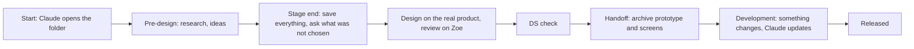

> Demo with example data. This page explains the idea behind the library in plain words.

## The problem

Today, the knowledge behind a design is spread across Figma, Slack, Confluence and personal laptops. To learn why a screen looks the way it does, people ask the designer. If the designer has left or forgotten, the answer is lost.

## The idea

One place per task, kept forever, readable by anyone without asking the designer.

| Place | What it is for | How long it lasts |
|---|---|---|
| Designer's laptop | Doing the work | The designer's own |
| Zoe | Showing the prototype while work is active, collecting comments | Temporary, deleted after a year |
| Confluence | Recording decisions | Permanent |
| **This library (GitHub)** | **Keeping everything about the task, and this showcase** | **Permanent** |

## A task, step by step

1. **Start.** The designer tells Claude the Jira key. Claude opens a folder and writes the ID card. *Why: so everything has a known place from day one.*
2. **Pre-design.** Research, benchmark, flow map, ideas. *Why: work happens on the laptop first, saving every small step would slow the designer down.*
3. **Stage end.** Claude saves everything produced for the task and asks: "What did you not choose, and why?" *Why: years later someone will ask why an option is missing. The answer must be written down.*
4. **Design and review.** Built on the real product, shown on Zoe for comments. *Why: comments pinned on the screen are the fastest feedback, but Zoe is temporary.*
5. **DS check.** Exceptions get a DS approval. *Why: so testers do not flag approved exceptions again.*
6. **Handoff.** Claude archives the clickable prototype, the screens and the developer notes here. *Why: Zoe deletes the prototype after a year, this copy stays.*
7. **Development.** If something is built differently, the designer tells Claude. Claude finds every affected file and updates it after approval. *Why: otherwise the documentation is wrong within a month.*
8. **Released.** The status changes and a snapshot is kept. *Why: anyone can see what was handed over and what went live.*

## What the designer does

Tell Claude when work starts, design, approve the list at each stage end, say what was not chosen, and tell Claude when something changes. Claude does the saving, naming and updating.
