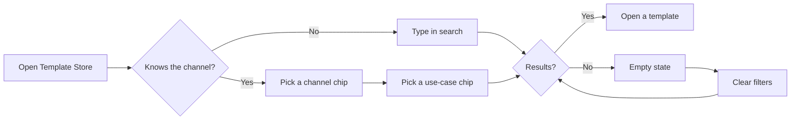

# Flow map

> Output of the flow-map skill, Jun 13, 2026. Example data.

## Steps that changed compared to today

| Step | Today | New |
|---|---|---|
| Find by channel | Scroll and read tags on every card | One chip |
| No results | Blank grid | Empty state with a way out |
